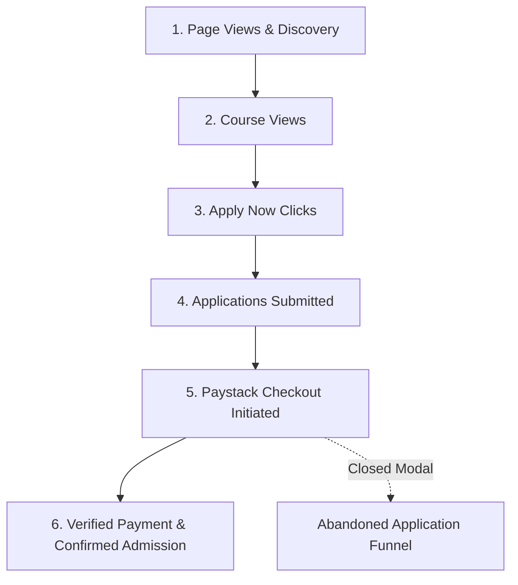

# Dave Techs Academy — Analytics, Event Tracking & Conversion Specification

**Product:** Dave Techs Academy\
**Document Version:** 1.0\
**Status:** Architecture & Telemetry Specification\
**Scope:** Phase 21 — Analytics

---

## 1. Executive Summary

The Analytics & Telemetry system for Dave Techs Academy provides full visibility into visitor behavior, course discovery interest, and the multi-stage student enrollment funnel:

$$\text{Discovery} \longrightarrow \text{Course Exploration} \longrightarrow \text{Apply Now Intent} \longrightarrow \text{Application Submission} \longrightarrow \text{Checkout Initialized} \longrightarrow \text{Payment Confirmed}$$

This document outlines the standard event taxonomy, funnel calculation formulas, drop-off rate tracking, and provider integration architecture (Google Analytics 4, PostHog, Plausible, and local real-time telemetry).

---

## 2. Event Taxonomy & Dictionary

| Event Name | Trigger Location | Payload Attributes | Funnel Stage |
| :--- | :--- | :--- | :--- |
| `page_view` | Global Router (`App.tsx` / `useAnalytics`) | `path`, `title`, `referrer`, `device`, `viewportWidth` | 1. Discovery |
| `course_view` | `CourseDetail.tsx` mount | `courseId`, `slug`, `title`, `category`, `price` | 2. Course Discovery |
| `course_search` | `Courses.tsx` search box | `query`, `resultCount` | 2. Course Discovery |
| `course_filter` | `Courses.tsx` filter bar | `category`, `level`, `mode`, `resultCount` | 2. Course Discovery |
| `apply_now_click` | `CourseCard.tsx`, `Hero.tsx`, `CourseDetail.tsx` | `courseId`, `courseTitle`, `location`, `buttonVariant` | 3. Intent |
| `signup_start` | `Signup.tsx` form focus | `source` | 3. Intent |
| `signup_complete` | `AuthContext.tsx` registration success | `userId`, `email`, `role` | 3. Account Creation |
| `application_start` | `Apply.tsx` mount | `courseId`, `courseTitle`, `learningMode` | 4. Application Flow |
| `application_complete` | `Apply.tsx` form submit | `applicationId`, `applicationNumber`, `courseId`, `tuitionAmount`, `cohort` | 4. Application Flow |
| `payment_start` | `Apply.tsx` / `PaystackModal.tsx` open | `applicationId`, `courseId`, `amount`, `reference` | 5. Payment Funnel |
| `payment_success` | `paystack.ts` verification success | `applicationId`, `reference`, `amount`, `channel`, `courseTitle` | 6. Enrollment |
| `payment_failed` | `paystack.ts` verification failure | `applicationId`, `reference`, `reason` | Drop-off / Retry |
| `payment_abandoned` | `Apply.tsx` Paystack modal close | `applicationId`, `reference`, `courseTitle` | Drop-off / Recovery |
| `contact_submit` | `Contact.tsx` message send | `messageId`, `subject`, `courseInterest` | Lead Generation |
| `syllabus_request` | `CourseDetail.tsx` inquiry submit | `courseId`, `courseTitle`, `email` | Lead Generation |

---

## 3. Funnel Metrics & Conversion Formulas

### 3.1 Primary Conversion Metrics

1. **Overall Visitor-to-Enrolled Conversion Rate ($CR_{overall}$)**:
   $$CR_{overall} = \left( \frac{\text{Successful Payments}}{\text{Unique Sessions or Pageviews}} \right) \times 100$$

2. **Apply-to-Application Completion Rate ($CR_{app}$)**:
   $$CR_{app} = \left( \frac{\text{Completed Applications}}{\text{Apply Now Clicks}} \right) \times 100$$

3. **Application-to-Payment Conversion Rate ($CR_{paid}$)**:
   $$CR_{paid} = \left( \frac{\text{Successful Payments}}{\text{Completed Applications}} \right) \times 100$$

4. **Application Abandonment Rate ($AR$)**:
   $$AR = \left( \frac{\text{Abandoned or Unpaid Applications}}{\text{Total Completed Applications}} \right) \times 100$$

---

## 4. Privacy, Performance & Telemetry Architecture

1. **Zero Render Blocking**: All analytics telemetry events are dispatched asynchronously using non-blocking microtasks without affecting UI responsiveness or FPS.
2. **Local Telemetry Persistence**: Events are recorded into `devtechs_analytics_events` with FIFO rotation (capped at the latest 500 events) for real-time in-app dashboard visualization.
3. **External Provider Ready**: Support for:
   - **Google Analytics 4 (GA4)** via `gtag.js` measurement ID (`G-XXXXXXXXXX`).
   - **PostHog** / **Plausible** via script configuration in Admin Analytics Settings.
4. **Data Export & Compliance**: Administrators can export all telemetry event streams to CSV or JSON for deep offline analysis.
