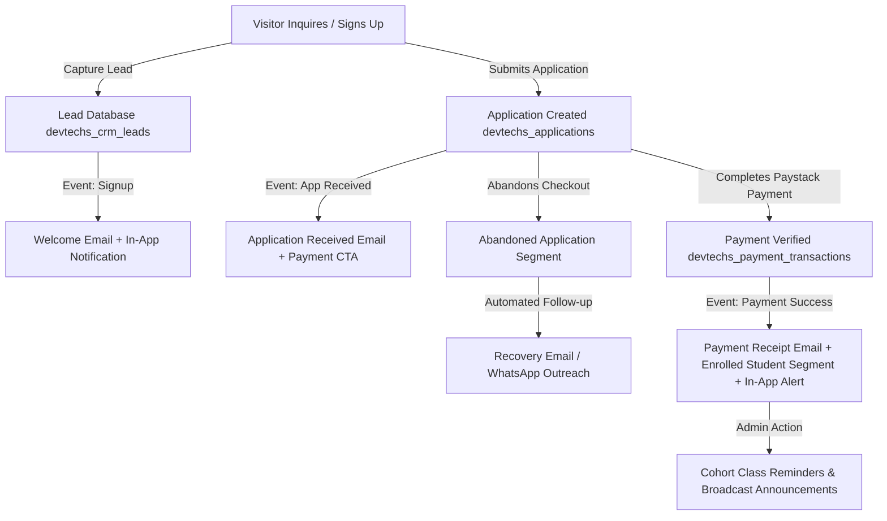

# Dave Techs Academy — CRM, Email, WhatsApp & SMS Integration Architecture

**Product:** Dave Techs Academy\
**Document Version:** 1.0\
**Status:** Architecture & Provider Evaluation Specification\
**Scope:** Phase 20 — CRM & Communication

---

## 1. Executive Summary

As Dave Techs Academy scales both online virtual training and physical campus cohorts (Abeokuta, Victoria Island Lagos, Ikeja, and Ibadan), effective and reliable communication is vital for:
1. **Admissions Conversion**: Immediate response to course inquiries and abandoned application follow-ups.
2. **Transaction Receipts & Verification**: Sending instant, branded payment receipts and cohort confirmation details.
3. **Classroom & Cohort Operations**: Automated schedule reminders, orientation notifications, and learning portal access links.
4. **Student Engagement**: Targeted course announcements, alumni upgrades, and career opportunities.

This document outlines the evaluation, selection, and implementation architecture for **CRM**, **Email**, **WhatsApp**, and **SMS** providers tailored for Nigerian and international operations.

---

## 2. Provider Evaluation Matrix

### 2.1 Email Service Provider (Transactional & Marketing)

| Provider | Primary Strengths | Local / Global Deliverability | Pricing Model | Recommendation |
| :--- | :--- | :--- | :--- | :--- |
| **Resend** *(Selected Primary for Transactional)* | Modern developer-first API, first-class React/HTML email rendering, sub-second delivery, exceptional inbox placement. | Excellent globally & across Nigerian ISP mailboxes (Gmail, Yahoo, iCloud, custom domains). | Free tier: 3,000 emails/mo. Pro tier: $20/mo for 50,000 emails. | **Primary Choice for Transactional**: Account creation, application receipts, payment confirmations, and class reminders. |
| **SendGrid (Twilio)** | Enterprise-grade scale, rich analytics, dedicated IP options, webhook delivery callbacks. | High deliverability with SPF/DKIM/DMARC verification. | Free: 100 emails/day. Essentials: $19.95/mo for 50,000 emails. | **Alternative / Enterprise Backup**. |
| **Brevo (formerly Sendinblue)** | Combined transactional email + CRM contact segmentation + automated drip sequences. | Very good deliverability, built-in marketing automation. | Free tier: 300 emails/day. Starter: ~$25/mo for 20,000 emails. | **Secondary Choice for Marketing Drips & Broadcasts**. |
| **Mailchimp** | Strong visual campaign builder, rich audience demographic reporting. | High deliverability for marketing newsletters. | Free tier: 500 contacts. Essentials: $13/mo. | Better suited for non-technical marketing teams; less flexible for API-driven triggers. |

---

### 2.2 WhatsApp Integration (Conversational Admissions & Broadcasts)

| Integration Strategy | Mechanics | Student Experience | Cost & Compliance | Recommendation |
| :--- | :--- | :--- | :--- | :--- |
| **1. Direct `wa.me` Deep-Links** *(Active In-App)* | Client-side sanitized `https://wa.me/234...` URL generation with pre-filled context-aware inquiry text. | Instant 1-click launch into WhatsApp with Dave Techs admissions advisors. | **Zero Cost**. No template approvals required. | **Immediate Production Feature**: Embedded in CRM Lead inspection modals, student directory, and course inquiry responses. |
| **2. WhatsApp Business Cloud API (Meta Direct)** | Official Meta Graph API integration with verified Green Badge (`Dave Techs Academy`). | Automated template messages (Application receipts, payment notifications, cohort onboarding). | Meta conversation-based pricing (~$0.0315 per marketing conversation in Nigeria). Requires pre-approved message templates. | **Selected for Automated High-Volume Cohort Broadcasts**. |
| **3. Twilio / Termii WhatsApp API** | Aggregated WhatsApp Business messaging layer. | Webhook-driven two-way messaging for student support bots. | Termii: ₦15–₦25 per delivered session. Twilio: $0.005 + Meta conversation fee. | **Recommended for multi-agent support ticketing**. |

---

### 2.3 SMS Gateway (Nigeria & International)

| Gateway Provider | Network Routing & DND Bypass | Nigerian Telco Latency | Pricing (NGN / USD) | Recommendation |
| :--- | :--- | :--- | :--- | :--- |
| **Termii** *(Selected Primary for Nigeria)* | **Direct Tier-1 Telco routes** with automatic Do-Not-Disturb (DND) bypass routing; custom alphanumeric Sender ID (`DaveTechs`). | < 3 seconds delivery latency on MTN, Airtel, Glo, 9mobile. | ~₦3.50 to ₦5.20 per SMS unit (160 characters). | **Primary Choice for Nigeria**: OTP verification, emergency campus schedule updates, payment alerts. |
| **Twilio SMS** | Global carrier reach, extensive international phone number support. | Good global reach; standard international route into Nigeria. | ~$0.055 per SMS to Nigeria. | **Selected for International Students outside Nigeria**. |
| **Africa's Talking** | Pan-African telecom infrastructure across Nigeria, Ghana, Kenya, Rwanda. | High reliability for African cross-border expansion. | ~₦4.00 per SMS unit in Nigeria. | **Secondary Regional Backup**. |

---

## 3. CRM Data Model & Lead Lifecycle

### 3.1 Lifecycle Trigger Events

1. **`triggerSignupWelcome`**:
   - Fired upon student registration (`AuthContext.signup`).
   - Syncs lead with `source: 'signup_form'`.
   - Sends branded HTML Welcome Email.
   - Logs entry in `devtechs_sent_communications`.
   - Dispatches in-app notification to student dashboard.

2. **`triggerApplicationReceived`**:
   - Fired upon application submission (`Apply.tsx`).
   - Captures lead with `courseId`, `tuitionAmount`, `learningMode`, `branchId`, `cohort`.
   - Sends branded HTML Application Confirmation Email with application number and tuition details.
   - Dispatches in-app notification under `application` category.

3. **`triggerPaymentReceipt`**:
   - Fired upon server-side Paystack payment verification (`paystack.ts` -> `verifyPayment`).
   - Promotes lead to `enrolled_students` segment with `paymentStatus: 'successful'`.
   - Sends branded HTML Payment Receipt Email containing Paystack transaction reference and cohort schedule.
   - Dispatches in-app notification linking to `/dashboard/payments` receipt modal.

4. **`triggerPaymentAbandoned`**:
   - Fired when Paystack checkout modal is closed before payment completion.
   - Places lead in `abandoned_applications` segment for automated recovery outreach.

---

## 4. Audience Segmentation Architecture

The segmentation engine dynamically computes real-time lead groups from stored leads and application records:

1. **`all_leads`**: All registered visitors and course inquiries.
2. **`enrolled_students`**: Learners who have paid tuition and have confirmed admission.
3. **`unpaid_applications`**: Applicants with pending admission awaiting tuition payment.
4. **`abandoned_applications`**: Prospects who initiated checkout but abandoned before completion.
5. **`course_software_dev`**: Leads interested in Frontend, Backend, Python, Fullstack development.
6. **`course_cybersecurity`**: Leads interested in Cyber Defense and Ethical Hacking.
7. **`course_design`**: Leads interested in UI/UX and Graphics Design.
8. **`course_data_ai`**: Leads interested in Data Science, Machine Learning, and AI.
9. **`course_cloud_devops`**: Leads interested in Cloud Engineering and DevOps.

---

## 5. Branded HTML Email Templates

All email communications adhere strictly to the **Dave Techs Academy Visual Identity** (Deep Obsidian `#0a0a0a`, Rich Charcoal `#121212`, Bright Gold `#d4af37`, Crisp White `#f5f5f5`):

- **Template 1: Welcome Email (`welcome`)**: Account creation confirmation, portal login link, and curriculum overview.
- **Template 2: Application Received (`application_received`)**: Formal application acknowledgement with application ID, selected campus/cohort, and payment CTA.
- **Template 3: Payment Receipt (`payment_receipt`)**: Verified transaction receipt, Paystack reference, course tuition confirmation, and orientation schedule.
- **Template 4: Abandoned Checkout Recovery (`payment_abandoned_reminder`)**: Gentle reminder with cohort seat reservation urgency and 1-click resume link.
- **Template 5: Class & Orientation Reminder (`class_reminder`)**: Cohort kickoff schedule, venue location, Google Meet link, and student checklist.
- **Template 6: Course Announcement (`course_announcement`)**: New batch openings, curriculum upgrades, and early-bird scholarship discounts.
- **Template 7: Custom Broadcast (`custom_broadcast`)**: Dynamic multi-segment academy announcements with variable token interpolation.

---

## 6. Security & Privacy Safeguards

1. **No Sensitive API Keys on Frontend**: In production, provider API secret keys (Resend `re_*`, SendGrid `SG.*`, Termii Secret Key) reside strictly in secure backend environment variables or edge worker functions.
2. **Data Sanitization**: All contact information, emails, and phone numbers are sanitized using `sanitizeEmail`, `sanitizePhone`, and `sanitizeString` utilities before storage or outbound dispatch.
3. **Opt-Out Compliance**: All outbound broadcast communications include standard footer unsubscribe notices and direct contact options (`admissions@devtechs.ng`).
