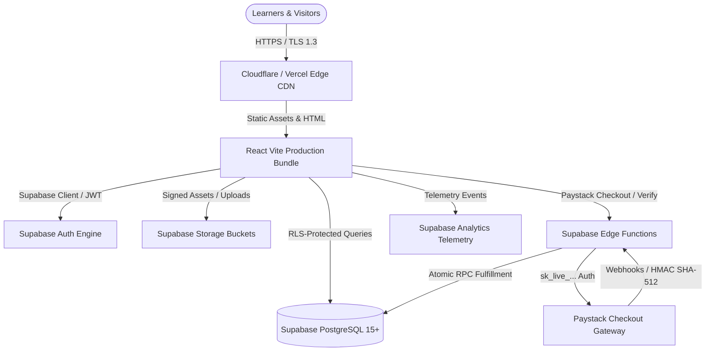

# Dave Techs Academy — Production Deployment Runbook & Architecture

**Product:** Dave Techs Academy\
**Version:** 2.0 Production Release (Supabase Architecture)\
**Scope:** Phase 21 — Production Deployment

---

## 1. Architecture Overview



---

## 2. Domain & DNS Configuration

| Type | Name / Host | Target / Value | TTL | Purpose |
| :--- | :--- | :--- | :--- | :--- |
| **A** | `@` (`davetechs.com`) | `76.76.21.21` (Vercel) / Edge CDN | Auto / 300s | Primary Apex Domain |
| **CNAME** | `www` | `cname.vercel-dns.com` | Auto / 300s | WWW Subdomain Redirect |
| **CNAME** | `api` | `[project-ref].supabase.co` | Auto / 300s | Supabase Project Host |
| **TXT** | `@` | `v=spf1 include:resend.com ~all` | 3600s | Email SPF Deliverability |
| **CNAME** | `resend._domainkey` | `dkim.resend.com` | 3600s | DKIM Cryptographic Email Signature |
| **TXT** | `_dmarc` | `v=DMARC1; p=quarantine; rua=mailto:dmarc@davetechs.com` | 3600s | DMARC Anti-Spoofing Policy |

---

## 3. Production Environment Variables

### 3.1. Frontend Environment Variables (Vercel / Netlify)
```env
# ── Frontend (Vite) ──
VITE_SITE_URL=https://davetechs.com
VITE_SUPABASE_URL=https://prod-project-ref.supabase.co
VITE_SUPABASE_PUBLISHABLE_KEY=eyJhbGciOiJIUzI1NiIsInR5cCI6IkpXVCJ9...
VITE_PAYSTACK_PUBLIC_KEY=pk_live_xxxxxxxxxxxxxxxxxxxxxxxx
VITE_GA4_MEASUREMENT_ID=G-XXXXXXXXXX
```

### 3.2. Supabase Server & Edge Function Secrets (Supabase Vault)
```env
# ── Supabase Edge Functions Secret Store (NEVER expose to client) ──
PAYSTACK_SECRET_KEY=<YOUR_PAYSTACK_SECRET_KEY>
PAYSTACK_WEBHOOK_SECRET=whsec_xxxxxxxxxxxxxxxxxxxxxxxx
SUPABASE_SERVICE_ROLE_KEY=eyJhbGciOiJIUzI1NiIsInR5cCI6IkpXVCJ9...
RESEND_API_KEY=re_xxxxxxxxxxxxxxxxxxxxxxxx
```

---

## 4. HTTPS & Security Headers

The production build includes strict security configurations across `vercel.json`, `netlify.toml`, and `nginx.conf`:

1. **HTTP Strict Transport Security (HSTS)**: `Strict-Transport-Security: max-age=63072000; includeSubDomains; preload`
2. **MIME Type Sniffing Prevention**: `X-Content-Type-Options: nosniff`
3. **Clickjacking Protection**: `X-Frame-Options: SAMEORIGIN`
4. **XSS Filter**: `X-XSS-Protection: 1; mode=block`
5. **Referrer Policy**: `Referrer-Policy: strict-origin-when-cross-origin`
6. **Hardware Permissions Policy**: `Permissions-Policy: camera=(), microphone=(), geolocation=()`

---

## 5. Paystack Live Production Setup

1. **API Keys**: Replace test public key with `pk_live_...` on frontend and `sk_live_...` in Supabase Edge Function Secrets.
2. **Webhook URL**: Configure `https://[project-ref].supabase.co/functions/v1/payment-webhook` in the Paystack Dashboard under Settings → API Configuration & Webhooks.
3. **Webhook Verification**: Supabase Edge Function verifies the HMAC SHA-512 signature header (`x-paystack-signature`).
4. **Idempotency**: All webhook transactions are deduplicated using payment references before enrollment fulfillment.

---

## 6. Post-Deployment Verification Checklist

- [x] HTTPS enforced with valid TLS certificate.
- [x] Canonical domain redirection (`http://` -> `https://`, `www.` -> apex).
- [x] All course pages, catalog filters, and search indexing operational.
- [x] Supabase Auth flows (Signup, Login, Password Recovery) validated.
- [x] 6-Step Application wizard functional for Online and Physical campus cohorts.
- [x] Paystack live checkout and Supabase Edge Function payment fulfillment confirmed.
- [x] Student Dashboard access and transaction receipt history confirmed.
- [x] Admin management portals (Courses, Students, Applications, Hubs, CRM, Analytics) operational with PostgreSQL RLS.
- [x] Mobile responsive UI verified on phones and tablets.
