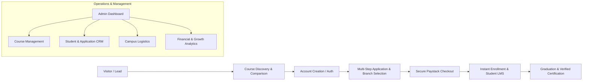

# Executive Overview & Platform Summary: Dave Techs Academy

**Document Type:** Stakeholder & Leadership Executive Brief  
**Platform:** Dave Techs Academy Digital Platform & Web Application  
**Tech Stack:** React 18 · TypeScript · Vite · Paystack · Responsive Modern CSS  
**Primary Brand Identity:** Black & Gold Luxury Tech Aesthetic (Dark/Light Modes)  

---

## 1. Executive Summary

**Dave Techs Academy** is an end-to-end technology education and workforce development platform designed to bridge the gap between ambitious learners and high-demand tech careers. 

Unlike traditional static institutional websites, the platform functions as a **complete digital acquisition, enrollment, learning management, and administrative operating system**. It seamlessly integrates course discovery, multi-campus physical and online learning mode selection, automated Paystack payment processing, an interactive student LMS portal, and an administrative management dashboard.



---

## 2. Key Target Audiences & Value Propositions

| Stakeholder / Persona | Pain Points Addressed | Key Features & Value Delivered |
| :--- | :--- | :--- |
| **Prospective Students** | Unclear course requirements, lack of flexible learning options, opaque pricing. | Intuitive catalog, transparent pricing, online vs. physical campus choices, instant Paystack checkout, clear curriculum breakdown. |
| **Enrolled Learners** | Disconnected learning materials, missing receipts, untracked progress. | Dedicated Student Dashboard, interactive video/module classroom (LMS), assignment submission, digital receipts, verified certificates. |
| **Instructors & Mentors** | Fragmented communication, manual grading and attendance tracking. | Instructor directory, course alignment, curriculum management, student project review workflows. |
| **Academy Leadership & Admins** | Manual enrollment spreadsheets, disconnected payments, lack of business visibility. | Unified Admin Portal, real-time revenue analytics, student CRM, multi-campus management, automated communications. |

---

## 3. Core Product Features & Architectural Breakdown

### 3.1. Public-Facing Acquisition Engine
- **Hero & Trust Architecture:** Dynamic statistics counters (students trained, success rate, partner hiring rate), video/interactive showcase, and direct conversion funnels.
- **Advanced Course Catalog (17+ Tech Disciplines):**
  - *Engineering:* Frontend, Backend, Full-Stack, Python, DevOps & Cloud Computing, Software QA.
  - *Data & AI:* Data Analysis, Data Science, AI & Machine Learning.
  - *Design & Creative:* UI/UX Design, Product Design, Graphic Design, Video Editing.
  - *Security & Infrastructure:* Cybersecurity, Ethical Hacking, Computer Networking.
  - *Business & Growth:* Digital Marketing, WordPress & No-Code Development, Robotics.
- **Faceted Search & Filter Engine:** Instant filtering by skill level (*Beginner, Intermediate, Advanced*), learning mode (*Online, Physical, Hybrid*), duration, category, and price sorting.
- **Deep Course Detail Pages:** 
  - Module-by-module syllabus with weekly learning objectives.
  - Tangible capstone project outlines with industry tools.
  - Instructor credentials and student satisfaction ratings.
  - Pre-requisites and course-specific FAQs.
- **Multi-Campus Network (`/branches`):**
  - **Abeokuta Main Campus:** Tech Innovation Corridor, Oke-Mosan.
  - **Victoria Island Executive Campus:** Adeola Odeku Street, VI, Lagos.
  - **Ikeja Tech Hub:** Allen Avenue, Ikeja, Lagos.
  - **Ibadan Innovation Center:** Ring Road, Ibadan, Oyo State.
  - Features real-time amenity listings (high-spec labs, 24/7 solar power, Starlink/fiber internet), cohort batch times (*Morning, Afternoon, Weekend*), and map navigation.

---

### 3.2. Enrollment & Payment Infrastructure
- **Interactive Multi-Step Application Wizard (`/apply`):**
  - Program selection & campus cohort customization.
  - Background assessment & emergency contact collection.
  - Real-time application summary and pricing breakdown.
- **Paystack Payment Engine:**
  - Automated currency handling (NGN ₦) with public-key client security.
  - Idempotent payment reference generation (`DTA_PAY_*`) preventing duplicate charges.
  - Instant client-side & server-verified callback handling (`/payment/callback`).
  - Automatic invoice and PDF-ready digital receipt generation.
  - Integrated rate limiting and payload sanitization to protect against fraud.

---

### 3.3. Student Experience & Learning Portal (`/dashboard` & `/learn`)
- **Student Dashboard Overview:** Enrollment status, next upcoming classes, attendance metrics, and quick links.
- **Interactive LMS Classroom:**
  - Module-based progression with video lecture integration.
  - Rich markdown lecture notes, downloadable toolkits, and code sandboxes.
  - Capstone project submission and instructor feedback loops.
- **Applications & Payments Ledger:** Full historical transaction archive with downloadable tax invoices.
- **Digital Certificate Verification (`/verify/:certId`):**
  - Tamper-proof digital credentials issued upon course graduation.
  - QR-verifiable public validation page for employers and LinkedIn sharing.
- **Affiliate & Referral Engine (`/affiliate`):**
  - Unique student referral links, commission metrics, and promotional asset toolkits.

---

### 3.4. Academy Admin & Management Suite (`/admin`)
- **Executive Analytics Hub:** Real-time metrics on gross revenue, active cohort enrollment, conversion ratios, and popular tech tracks.
- **Course & Curriculum Manager:** Full control over course offerings, pricing tiers, schedules, and syllabus revisions.
- **Student & Application CRM:** Lifecycle pipeline (*New Application → Payment Pending → Enrolled → Active Student → Alumnus*) with direct bulk communication tools.
- **Campus & Facility Logistics:** Management of branch capacity, cohort timings, and workstation availability.
- **Automated CRM & Communication:** Pre-configured trigger workflows for welcome onboarding, payment confirmation, cohort kickoff reminders, and lead follow-ups.

---

## 4. Technical Architecture & Security Highlights

```
┌────────────────────────────────────────────────────────┐
│                   React 18 Single Page App             │
│            TypeScript · React Router v6 · Vite         │
└───────────────┬─────────────────────────┬──────────────┘
                │                         │
┌───────────────▼─────────────┐ ┌─────────▼──────────────┐
│       UI / Design System    │ │    Application Services │
│  - Black & Gold Theme Engine│ │  - Auth & Role Guards  │
│  - CSS Custom Properties    │ │  - Paystack Gateway     │
│  - Glassmorphic Cards       │ │  - CRM & Notification   │
│  - Responsive Navigation    │ │  - Analytics Tracking   │
└─────────────────────────────┘ └─────────┬──────────────┘
                                          │
                                ┌─────────▼──────────────┐
                                │   Data & Storage Layer  │
                                │  - Seed Repositories   │
                                │  - LocalStorage Engine │
                                │  - Rate Limiting Cache │
                                └────────────────────────┘
```

1. **Brand System & UX Polish:** Custom black & bright gold palette with dark/light mode toggle, high-contrast accessible typography, smooth micro-interactions, and mobile-first responsiveness.
2. **Enterprise Frontend Security:** Strict separation of public and secret keys, zero client-side credential exposure, XSS input sanitization, and client-side rate limiters on payment initialization.
3. **Deployment Readiness:** Production-ready configurations for Docker containerization, Nginx reverse proxy, Vercel, and Netlify edge deployment.

---

## 5. Strategic Roadmap & Future Expansion

- **Phase 1 (Current):** Complete responsive web app, full catalog, online/campus enrollment, Paystack payment integration, Student Dashboard, Admin operations, and Certificate verification.
- **Phase 2 (Upcoming):** Live interactive classroom video streaming (Zoom/WebRTC integration), mobile native apps (iOS/Android), and enterprise B2B corporate training portal.
- **Phase 3 (Scale):** Pan-African expansion to additional branches (Abuja, Port Harcourt, Accra, Nairobi) and automated AI-driven coding mentor assistants.

---

*Prepared by Dave Techs Academy Engineering & Product Team.*
